# Kitzo

**Kit de diagnóstico e manutenção do Windows que roda direto do pendrive.**
Pluga, dá dois cliques e um painel moderno abre no navegador para checar, reparar,
limpar e documentar o computador. Nada é instalado na máquina.

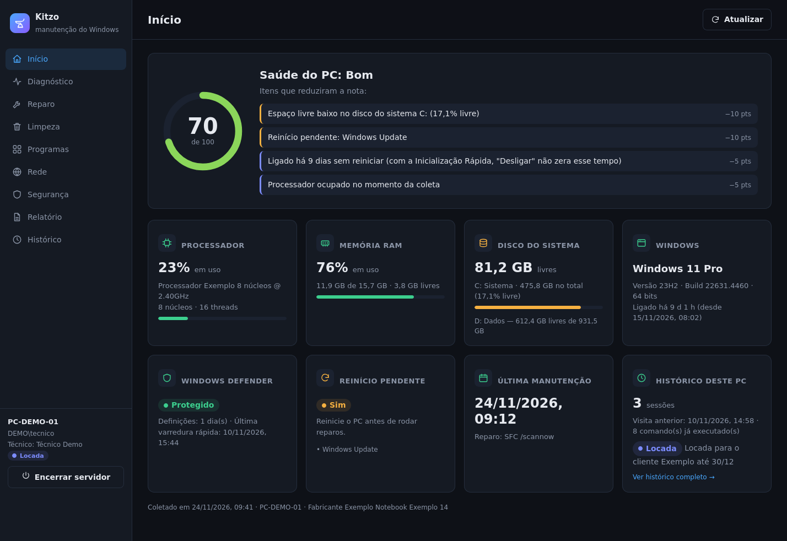

> Todas as imagens deste documento usam **dados fictícios** de demonstração.

---

## Sumário

- [Para que serve](#para-que-serve)
- [Destaques](#destaques)
- [Como usar](#como-usar)
- [Funcionalidades](#funcionalidades)
  - [Início: nota de saúde](#início-nota-de-saúde)
  - [Diagnóstico](#diagnóstico)
  - [Reparo](#reparo)
  - [Limpeza](#limpeza)
  - [Programas](#programas)
  - [Rede](#rede)
  - [Segurança](#segurança)
  - [Histórico por máquina](#histórico-por-máquina)
  - [Relatório](#relatório)
  - [Celular e telas pequenas](#celular-e-telas-pequenas)
- [Funcionamento em segundo plano](#funcionamento-em-segundo-plano)
- [Proteções](#proteções)
- [Registros gerados](#registros-gerados)
- [Requisitos](#requisitos)
- [Estrutura do projeto](#estrutura-do-projeto)
- [Para desenvolvedores](#para-desenvolvedores)
- [Solução de problemas](#solução-de-problemas)

---

## Para que serve

Para o **técnico de TI** que atende vários computadores e quer, em poucos minutos:

- saber **como o PC está** (nota de 0 a 100 com o motivo de cada desconto);
- encontrar a causa de lentidão, travamentos e falhas (discos, memória, inicialização, erros do sistema);
- **corrigir** o Windows (SFC, DISM, CHKDSK) e **liberar espaço** com segurança;
- atualizar e instalar programas, testar a rede e conferir a proteção do PC;
- **saber se aquele PC já foi atendido**, o que já foi feito nele e em que situação está (revisado, locado, com defeito…);
- entregar um **relatório** pronto para o cliente ou para o chamado.

## Destaques

| | |
|---|---|
| 🔌 **Portátil** | Roda de qualquer letra de unidade; usa só o PowerShell 5.1 que já vem no Windows 10/11 |
| 🖥️ **Painel moderno** | Tema escuro, menu lateral, responsivo, em português do Brasil |
| ⏱️ **Saída ao vivo** | Comandos demorados mostram o console, a barra de progresso e o cronômetro em tempo real |
| 🗂️ **Histórico por máquina** | Reconhece o PC pelo hardware e lembra tudo o que já foi feito nele |
| 👻 **Segundo plano** | Sem janela preta; fecha sozinho quando o navegador é fechado (mas nunca no meio de um reparo) |
| 🔒 **Seguro** | Só aceita conexões do próprio PC, exige token, lista fixa de ações e confirmação para tudo que altera o sistema |
| 📄 **Relatórios** | HTML para o cliente (imprimível em PDF) e TXT para chamados |

## Como usar

1. Copie a pasta `Ferramenta` para o pendrive.
2. No PC, dê dois cliques em **`Iniciar.bat`** e aceite o aviso de administrador do Windows.
3. O painel abre no navegador. Ao terminar, **feche o navegador**: a ferramenta se encerra sozinha.

> Fechou a aba sem querer? Rode o `Iniciar.bat` de novo: ele só reabre o painel, sem perder o que está em andamento.

---

## Funcionalidades

### Início: nota de saúde

Resumo do PC em uma tela: **nota de 0 a 100** e a lista do que a reduziu (pouco espaço, reinício pendente,
antivírus desligado, disco com falha…). Os cards mostram processador, memória, disco, versão do Windows,
Windows Defender, reinício pendente, última manutenção e o **histórico deste PC**.


### Diagnóstico

- **Discos:** saúde, temperatura, desgaste do SSD, horas ligado e erros (SMART);
- **Memória:** pentes instalados, slots e os programas que mais consomem;
- **Inicialização:** o que abre junto com o Windows e o que está desativado;
- **Eventos:** erros e falhas críticas recentes, os mais frequentes e a contagem de **desligamentos inesperados e telas azuis**.

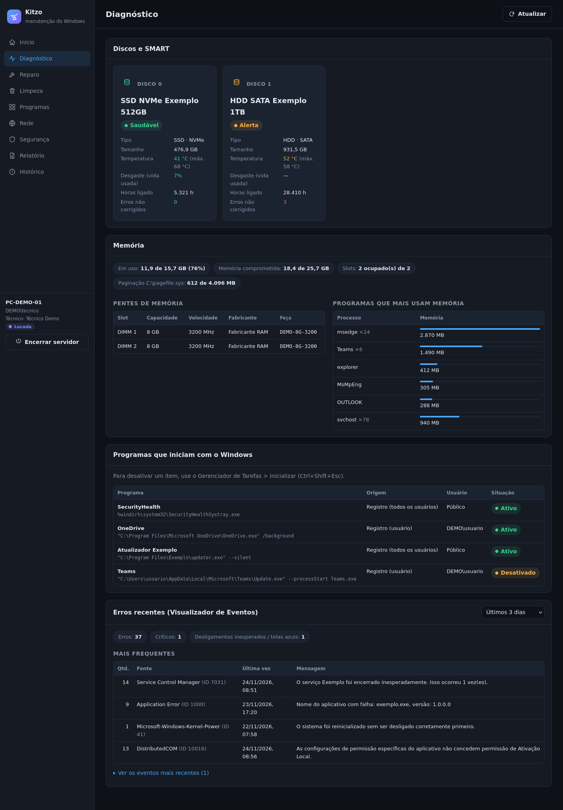

### Reparo

**SFC /scannow**, **DISM** (verificar e reparar a imagem do Windows) e **CHKDSK** (verificação online ou
correção completa agendada para o próximo reinício). Cada comando mostra a saída **ao vivo**, a barra de
progresso e o tempo decorrido. Ao lado de cada botão aparece **quando o comando foi executado pela última vez neste PC**.

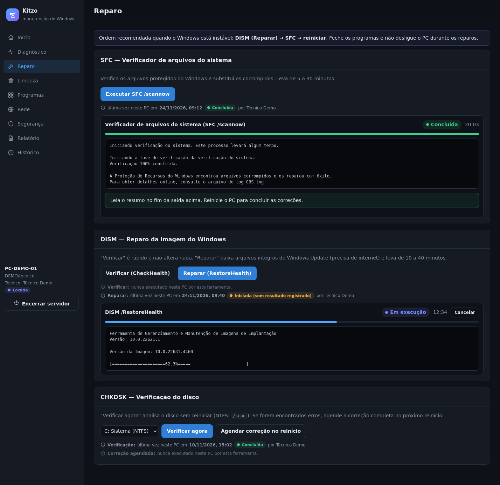

Toda ação que altera o sistema pede confirmação. Se o comando **já foi executado neste PC**, a confirmação avisa quando e com qual resultado:

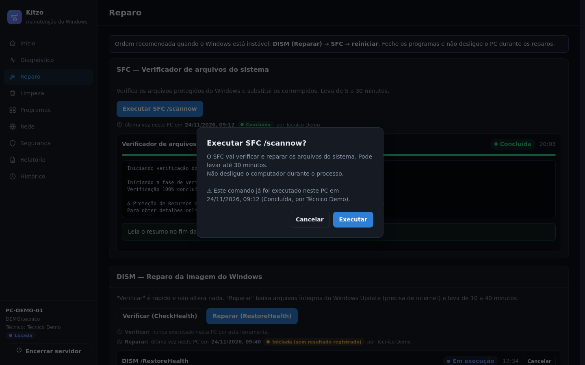

### Limpeza

Primeiro **analisa e mostra quanto será liberado**; só apaga o que for selecionado e confirmado.
Categorias: temporários dos usuários, temporários do Windows, Lixeira, cache do Windows Update e relatórios de erro.
Arquivos em uso são mantidos, e temporários com menos de 24 horas não são tocados.

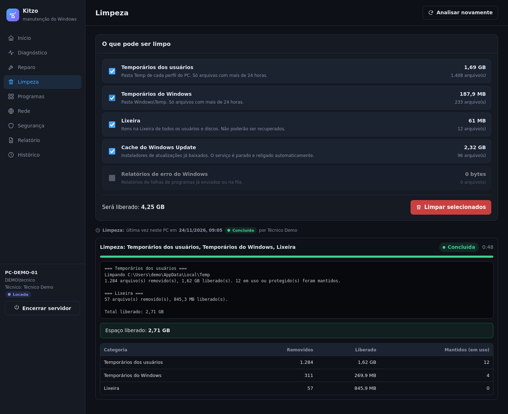

### Programas

Usa o **winget** (gerenciador oficial do Windows) para **procurar atualizações**, **atualizar um ou todos**,
**buscar e instalar** programas e **listar os instalados** com filtro. Sem winget, a lista vem do Registro do Windows.

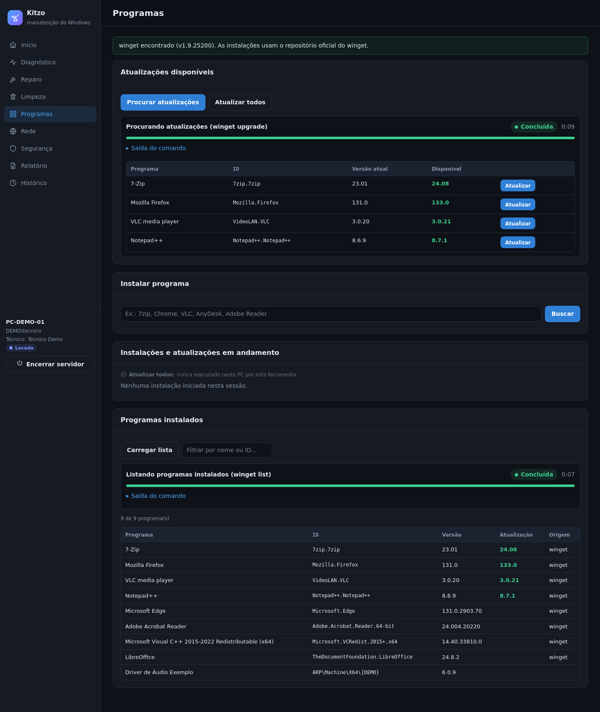

### Rede

Adaptadores com IP, gateway, DNS, MAC e velocidade; **teste de internet em etapas** (roteador → internet → DNS → web,
detectando inclusive redes que exigem login); **ping**, **renovar IP** e **limpar cache DNS**.

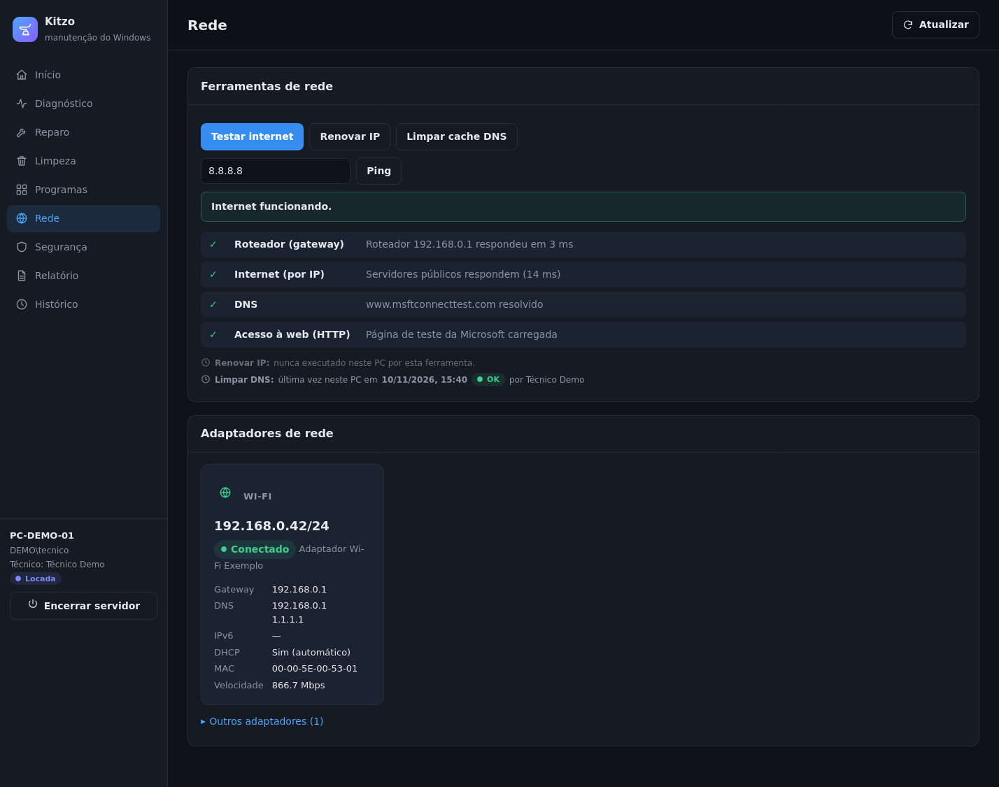

### Segurança

Windows Defender (proteção em tempo real, definições, varreduras), **firewall** por perfil (com botão para ativar),
UAC, Secure Boot, BitLocker, última atualização instalada e **ameaças dos últimos 30 dias**.
Ações: **varredura rápida**, **atualizar definições de vírus** e **procurar atualizações pendentes do Windows**.

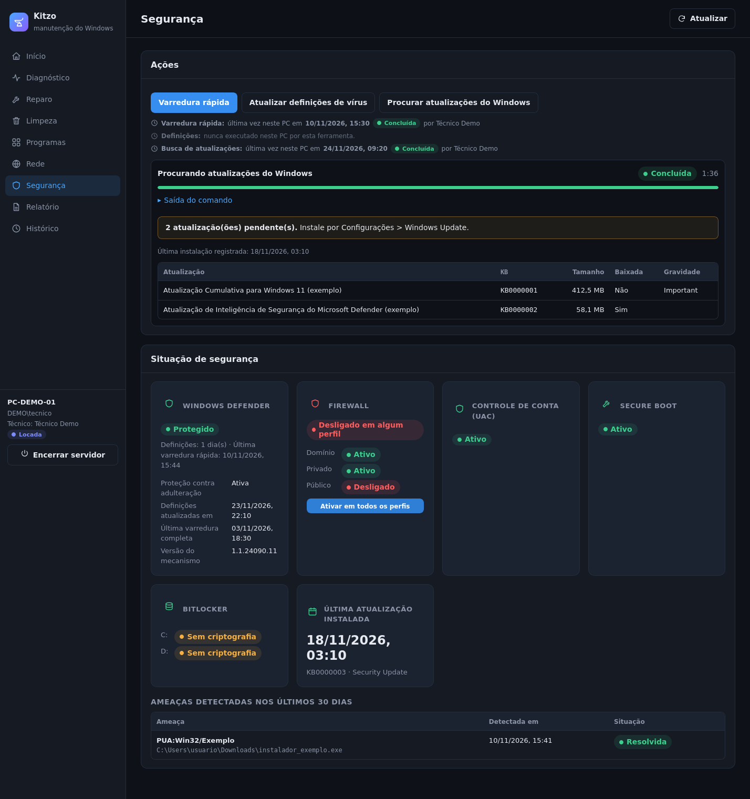

### Histórico por máquina

Responde "**este PC já passou por aqui? O que já foi feito nele? Em que situação está?**"

- Cada PC é reconhecido pelo **hardware** (UUID da placa-mãe + número de série), não pelo nome. Se for renomeado, o histórico continua.
- Tudo é registrado automaticamente: sessões, início e resultado de cada comando, ações rápidas e relatórios, com data e técnico.
- **Situação da máquina:** *Em revisão, Revisada, Locada, Disponível* ou *Com defeito*, com observação livre.
- Lista de **todas as máquinas atendidas com o pendrive** e planilha geral (CSV) para abrir no Excel.

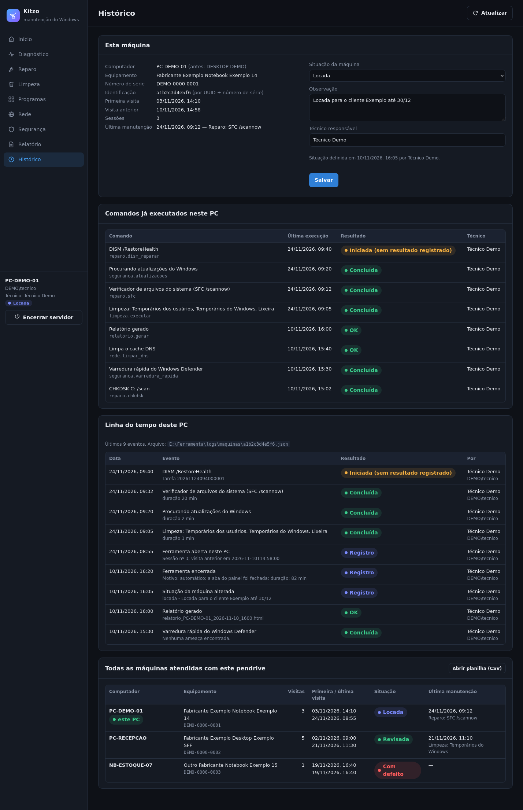

### Relatório

Gera, na pasta `logs` do pendrive, um relatório **HTML** (para o cliente, pode ser impresso em PDF) e um **TXT**
(para colar em chamados) com nota de saúde, hardware, discos, segurança, rede, erros recentes, programas instalados e
o histórico da máquina.

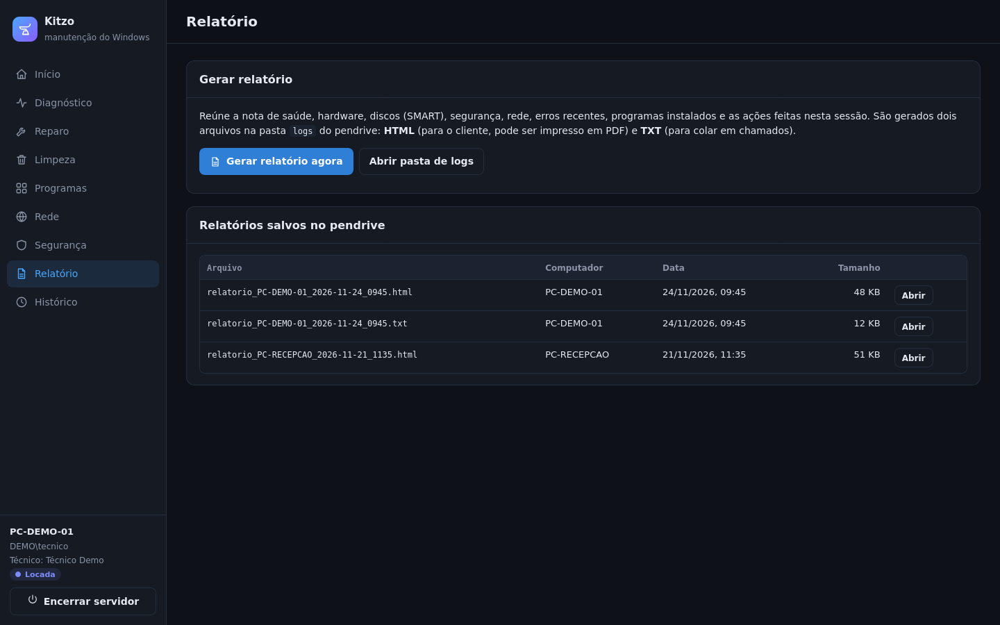

Exemplo do relatório HTML gerado:

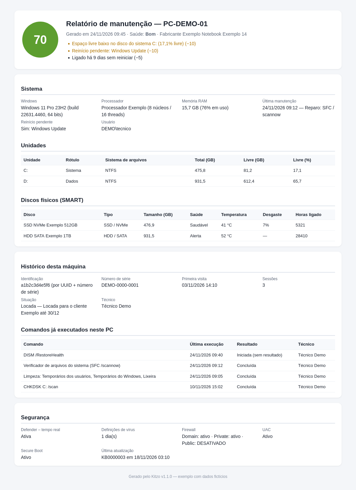

### Celular e telas pequenas

O painel se adapta a telas pequenas, com menu recolhível.

| Tela inicial | Menu aberto |
|---|---|
| 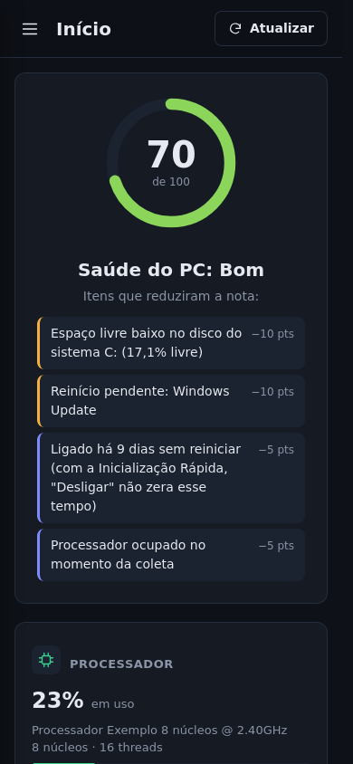 | 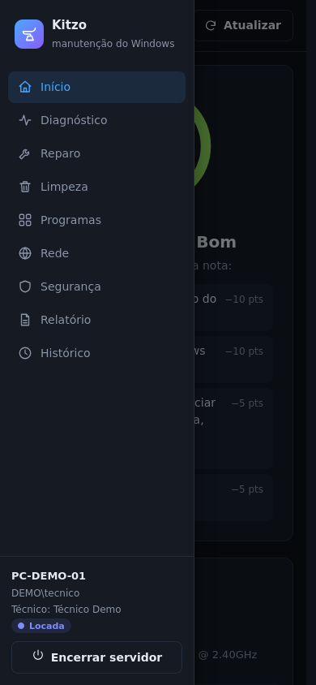 |

---

## Funcionamento em segundo plano

O servidor roda **oculto**: não há janela para manter aberta. Enquanto o painel está aberto, ele envia um sinal
a cada 8 segundos, e o servidor decide sozinho quando encerrar:

| Situação | Comportamento |
|---|---|
| Aba do painel fechada | Encerra após 20 s (um F5 não derruba nada) |
| Navegador fechado ou travado | Encerra após 90 s sem sinal |
| Painel nunca aberto | Encerra após 5 min |
| **Comando em andamento** (SFC, DISM, limpeza…) | **Espera terminar**, registra o resultado e só então encerra |
| `Iniciar.bat` executado de novo | Reabre o painel na ferramenta que já está aberta |

Para diagnosticar problemas, use o **`Iniciar-Console.bat`**, que abre o mesmo servidor com a janela visível.

## Proteções

- Servidor acessível **somente pelo próprio PC** (`localhost:8080`); conexões da rede são recusadas.
- **Token aleatório** novo a cada execução, exigido em toda chamada; outros sites abertos no navegador não conseguem usar o painel.
- O navegador **nunca envia comandos**: só pede ações de uma **lista fixa**, e cada parâmetro é validado.
- **Confirmação obrigatória** para tudo que altera o sistema (verificada também no servidor).
- A limpeza nunca segue atalhos de pasta (junções/links), nunca apaga a própria ferramenta e mantém arquivos em uso.
- Todas as ações ficam registradas.

## Registros gerados

Tudo fica na pasta `logs` do pendrive:

| Arquivo | Conteúdo |
|---|---|
| `maquinas\<id>.json` | Ficha de cada máquina: identificação, visitas, situação, última execução de cada comando e eventos |
| `historico_geral.csv` | Uma linha por evento, de todas as máquinas (abre no Excel) |
| `acoes_<PC>_<data>.log` | Log técnico detalhado, por computador e por dia |
| `tarefas\` | Saída completa de cada comando (guardada por 15 dias) |
| `relatorio_<PC>_<data>.html` / `.txt` | Relatórios gerados |

> Se o pendrive estiver protegido contra gravação, os registros vão para a pasta temporária do Windows e o painel avisa.

## Requisitos

- Windows 10 ou 11 (o PowerShell 5.1 já vem instalado);
- Permissão de administrador no PC;
- Um navegador (Edge, Chrome, Firefox…);
- Internet só para o que naturalmente precisa dela: DISM RestoreHealth, winget, definições de vírus e Windows Update.

## Estrutura do projeto

```
Ferramenta/
├─ Iniciar.bat              inicia a ferramenta (pede administrador, roda oculta)
├─ Iniciar-Console.bat      mesma coisa, com a janela visível (diagnóstico)
├─ servidor.ps1             núcleo: servidor local, segurança, tarefas, histórico
├─ modulos/                 uma área por arquivo
│   ├─ info.ps1             Início e nota de saúde
│   ├─ diagnostico.ps1      discos, memória, inicialização, eventos
│   ├─ reparo.ps1           SFC, DISM, CHKDSK
│   ├─ limpeza.ps1          análise e limpeza
│   ├─ programas.ps1        winget
│   ├─ rede.ps1             rede
│   ├─ seguranca.ps1        segurança
│   ├─ personalizacao.ps1   personalização do Windows (tema, barra de tarefas, Explorador)
│   ├─ relatorio.ps1        relatórios
│   ├─ historico.ps1        histórico por máquina
│   └─ tarefas/             scripts que rodam em processo separado
├─ web/                     painel (HTML, CSS e JavaScript puros, sem internet)
├─ docs/img/                imagens deste README
└─ logs/                    registros (criado automaticamente)
```

## Para desenvolvedores

Todo arquivo `.ps1` em `modulos\` é carregado automaticamente. Uma nova função é registrada assim:

```powershell
# modulos\exemplo.ps1
Registrar-Acao -Nome 'exemplo.reiniciar_spooler' -AlteraSistema -Descricao 'Reiniciar o spooler de impressão' -Bloco {
    param($P)
    Restart-Service -Name Spooler -Force
    [ordered]@{ mensagem = 'Spooler reiniciado.' }
}
```

- `-AlteraSistema` exige confirmação na tela e registra a ação no histórico da máquina.
- Comandos demorados usam `Iniciar-Tarefa`: saída ao vivo, progresso e histórico automáticos.
- Entradas do navegador são validadas com `Ler-Parametro` (lista de valores ou expressão regular).
- No painel (`web\app.js`), cada tela é uma função registrada em `Paginas`, com componentes prontos:
  `bloco()`, `tabela()`, `card()`, `iniciarTarefa()`, `marcadorUltima()` e `confirmar()`.

Cuidados ao editar: salve os `.ps1` em **UTF-8 com BOM** (senão os acentos quebram no PowerShell 5.1), mantenha os
`.bat` sem acentos e não use recursos exclusivos do PowerShell 7.

## Solução de problemas

| Sintoma | O que fazer |
|---|---|
| O painel não abriu | Rode o `Iniciar.bat` de novo. Se persistir, use o `Iniciar-Console.bat` e veja as mensagens. |
| Aviso de porta 8080 em uso | Outro programa usa a porta: feche-o e tente de novo. |
| "Sessão expirada" ou "Servidor desconectado" | A ferramenta foi encerrada: rode o `Iniciar.bat` de novo. |
| Defender "Indisponível" | Há outro antivírus instalado; ele aparece listado no card. |
| Programas sem winget | Instale ou atualize o "Instalador de Aplicativo" pela Microsoft Store. |
| Temperatura do disco "—" | O disco ou o controlador (USB, RAID) não informa SMART ao Windows. |
| Antivírus bloqueia os scripts | Libere a pasta da ferramenta no antivírus. |
